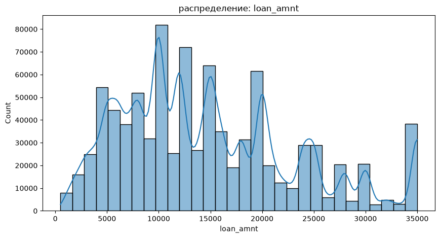
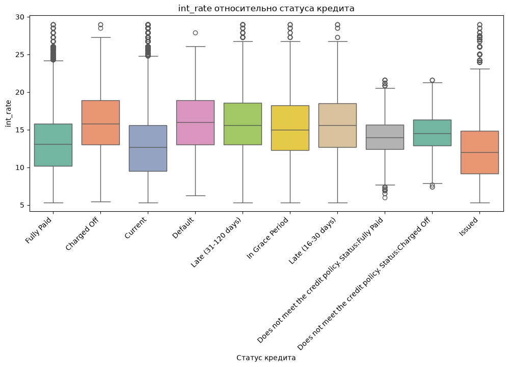
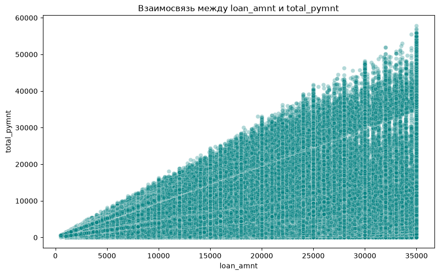
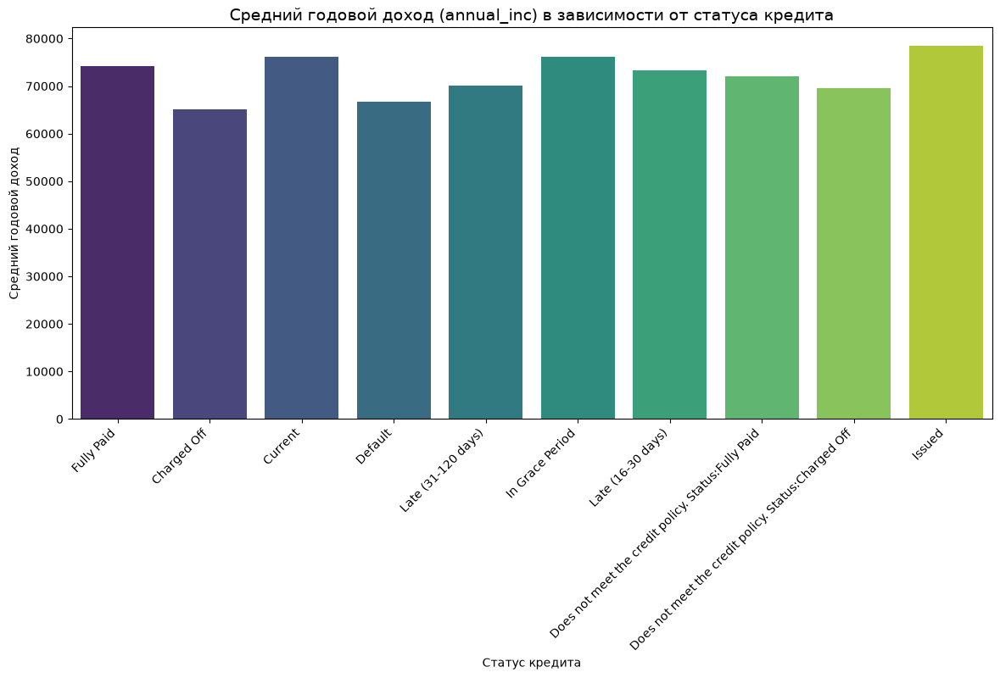

# Анализ кредитных рисков (Credit Risk Analysis)

##  О проекте
В данном проекте проведен разведочный анализ данных (EDA) для задачи оценки кредитных рисков. 
Цель — выявить аномалии в данных, проанализировать характеристики заемщиков и найти факторы, влияющие на дефолт по кредиту.

**Данные:** [Kaggle Credit Risk Dataset](https://www.kaggle.com/datasets/ranadeep/credit-risk-dataset)

##  Стек технологий
* Python 3.x
* Pandas, NumPy (обработка данных)
* Matplotlib, Seaborn (визуализация)
* KaggleHub (загрузка данных)

##  Что было сделано (Этапы анализа)

1. **Загрузка данных** из Kaggle через API (`kagglehub`).
2. **Очистка данных:**
   * Удалена группа совместных заявок (JOINT), так как её доля < 5% (дисбаланс классов).
   * Удалены поля с долей пустых значений > 20%.
   * Удалены "мусорные" поля, где > 80% занимает одно значение и менее 10 уникальных.
3. **Визуальный анализ (EDA):**
   * Построены гистограммы распределения ключевых числовых признаков.
   * Проведен анализ выбросов с помощью Boxplot.
   * Оценено влияние процентной ставки, долговой нагрузки (DTI) и суммы кредита на статус кредита.
4. **Корреляционный анализ:**
   * Построена матрица корреляции для выявления взаимосвязей между признаками.
   * Найдена самая сильная пара признаков и построен Scatterplot.

##  Ключевые выводы (Insights)
* **Процентная ставка (`int_rate`):** Заемщики с дефолтным статусом имеют значительно более высокие процентные ставки, что подтверждает гипотезу о том, что банк закладывает высокий риск в ставку.
* **Долговая нагрузка (`dti`):** У дефолтных заемщиков медианное значение DTI выше, что указывает на их высокую закредитованность.
* **Корреляция:** Наибольшая связь обнаружена между суммой кредита (`loan_amnt`) и общей суммой выплат (`total_pymnt`). Однако наличие невыплаченных кредитов (с нулевой суммой выплат) снижает коэффициент корреляции до 0.47.
##  Как запустить
1. Склонируйте репозиторий.
2. Установите зависимости: `pip install -r requirements.txt`
3. Запустите Jupyter Notebook `credit_risk_analysis.ipynb`.
## 📈 Visualizations

Here are some key visualizations from the analysis:

### Interest Rate by Loan Status

### Relationship between Loan Amount and Total Payment
 

### Average Annual Income by Loan Status

